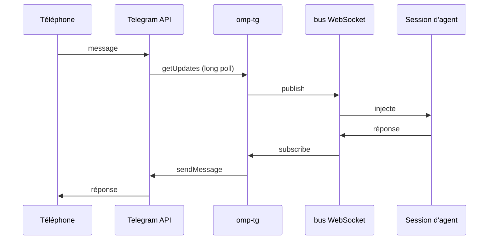
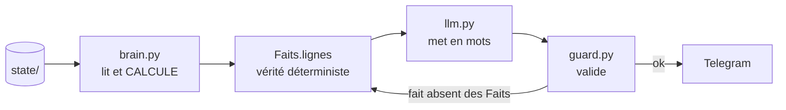

# bots

Trois bots personnels, chacun écrit pour résoudre un problème concret. Un seul dépôt parce qu'ils partagent la même contrainte : **un bot qui parle doit être fiable, pas bavard**.

Aucun token n'est versionné. Chaque bot lit son jeton depuis un fichier de configuration hors dépôt (`0600`) ou une variable d'environnement.

| Bot | Langage | Rôle |
|---|---|---|
| [`omp-tg`](omp-tg/) | Bun / TypeScript | pont Telegram ↔ session d'agent vivante |
| [`pote-telegram`](pote-telegram/) | Python | assistant scolaire, moteur de faits déterministe |
| [`mypybot`](mypybot/) | Python | automatisation de jeu par vision (capture + templates + clics) |

---

## omp-tg — Telegram comme interface d'un agent

Un daemon qui relie un téléphone à une session d'agent qui tourne sur la machine. Le téléphone n'exécute rien : il parle à la session.



**Choix d'architecture :**

- un seul consommateur `getUpdates` — pas de webhook, pas de port exposé ;
- le jeton vit dans `~/.config/omp-tg/config.json`, enregistré par `omp-tg --set-token`, permissions `0600` ;
- `--test "prompt"` permet de vérifier le pont sans passer par le téléphone.

Commandes exposées côté Telegram : `/status`, `/use <modèle>`, `/backends`, `/abort`.

```bash
omp-tg --set-token <TOKEN>   # enregistre et (re)démarre le service
omp-tg serve                 # daemon
omp-tg --test "ping"         # vérifie la chaîne complète
```

Service utilisateur fourni dans [`omp-tg/omp-tg.service`](omp-tg/omp-tg.service).

---

## pote-telegram — un bot qui n'a pas le droit d'inventer

Bot d'assistant scolaire : il lit les devoirs et les retards, produit un point du matin et des relances.

**Le problème qu'il résout n'est pas technique, il est de confiance.** Un LLM qui reformule des faits peut en inventer : « 23 devoirs en retard » alors qu'il y en a 27, une matière qui n'existe pas, une action annoncée mais jamais faite.

D'où la séparation stricte :



- **`brain.py`** ne fait que lire `state/` et calculer. Aucune génération de texte.
- **`llm.py`** met les faits en mots. Jamais bloquant : chaque fonction publique a un repli déterministe, et aucune exception ne traverse l'API.
- **`guard.py`** rejette toute sortie qui contient un fait absent de `Faits.lignes()` — dans ce cas la réponse déterministe part à la place.
- Une promesse d'action (`marquer()`) **écrit** dans le fichier puis le **relit** pour le prouver.

Les valeurs de repli ne sont jamais écrites dans le cache : sinon le cache se figerait sur du dégradé.

```bash
python -m pytest tests/     # suite de tests
```

---

## mypybot — automatiser un jeu par la vision

Automatisation d'un jeu mobile sur émulateur Android : capture d'écran, détection de templates, décision, clic.

- **`ppadb`** — pilote l'émulateur (capture, tap)
- **OpenCV** — correspondance de templates sur la grille de jeu
- **Ollama** — un modèle local pour les états que les templates ne couvrent pas

Le fichier `make_grid.py` découpe l'écran en grille ; `crop_template.py` fabrique les templates à partir d'une capture.

**Limite honnête :** c'est de l'automatisation d'interface, pas de la lecture mémoire. Tout ce qui sort de l'écran est invisible pour le bot — ce qui rend l'approche robuste aux mises à jour du jeu, mais lente.

```bash
pip install ppadb opencv-python numpy ollama
python bot_final.py
```

---

## Ce qui n'est pas ici

- les jetons : hors dépôt, jamais dans un commit ;
- les données : journaux, états, captures d'écran et sessions ne sont pas versionnés ;
- les bots tiers : ce dépôt ne contient que du code écrit ici.

## Licence

MIT — voir [LICENSE](LICENSE).
